# DarkStore Pulse: why 10-minute deliveries arrive late across India

**An end-to-end analysis of 386,593 orders from 52 dark stores in 8 Indian metros (Jan–Jun 2026), from a messy raw export to a diagnosis of every store and a ranked, simulated action plan.**

**▶ Live dashboard: [darkstore-pulse-india.streamlit.app](https://darkstore-pulse-india.streamlit.app/)** 

`SQL (DuckDB)` · `Python (pandas, statsmodels, scikit-learn, mlxtend)` · `Streamlit + Plotly` · `Power BI-ready star schema` · `pytest`

> **About the data:** real dark-store data isn't public, so the orders are **simulated** from an operational model of delivery (picking + rider wait + travel), modelled on each city's real traffic, seasons and festivals. The analysis had to find every problem from the order data alone. [How the data was built](#about-the-data).

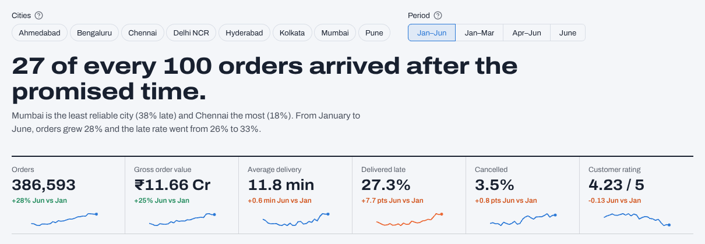

---

## The business question

A quick-commerce company promises 10-minute delivery in Bengaluru, Mumbai, Delhi NCR, Hyderabad, Pune, Chennai, Kolkata and Ahmedabad. Orders grew **28%** from January to June, but the share delivered after the promised time rose from **25.6% to 33.2%**. Operations wants to know:

1. Which cities and stores are failing, and **why** each one fails?
2. What is lateness costing in ratings, repeat orders and revenue?
3. What should be fixed first, and how much will each fix help?

## Key findings

| # | Finding | Evidence |
|---|---|---|
| 1 | **Mumbai misses the promise twice as often as Chennai.** | Late rate by city: Mumbai **37.5%**, Delhi NCR 28.5%, Pune 27.0%, Kolkata 26.9%, Bengaluru 25.9%, Hyderabad 25.1%, Ahmedabad 20.2%, Chennai **18.1%**. |
| 2 | **Traffic sets how far a store can reach on time.** | Regression (R² = 0.86): each extra km costs **3.1 min in Mumbai** vs 2.3 min in Ahmedabad. A true 10-minute promise reaches only **1.4 km in Mumbai**, where just 31% of orders are that close, vs 2.5 km in Chennai. |
| 3 | **Each city has its own seasons.** | Mumbai's late rate jumps from 35% in May to **45% in June** when the monsoon arrives. Delhi is worst in foggy January (30% vs 26% in March). Heavy rain makes **74%** of orders late across India; fog 45%; heatwaves 33%. |
| 4 | **The worst stores fail for three different reasons.** | Splitting delivery time into picking, rider wait and travel: **rider shortage** at Whitefield (BLR07) and Madhapur (HYD02), **slow picking** at Electronic City (BLR10) and Dadar (MUM05), and **long distances** at Thane West, Salt Lake, Gurugram Sector 56 and others. |
| 5 | **City-adjusted alerts catch real incidents without false alarms.** | A plain week-over-baseline rule fires **9 alerts**, 7 of them caused by Mumbai's monsoon and Pune's June rain. Subtracting each city's own swing leaves the **2 real incidents**: HSR Layout lost half its riders from 18 May (late 22% → 60%, still ongoing), and Gurugram Sector 56 had a two-week rider shortage in April (29% → 66%, resolved). |
| 6 | **Lateness costs repeat business.** | New customers whose first order was late re-ordered within 30 days **9.6 points less often** (58.7% vs 68.3%). Ratings fall from **4.7 to 3.4** for orders just 0–3 minutes late. 6,868 orders were cancelled because delivery was taking too long (≈ ₹21 L in lost order value). |
| 7 | **Empty shelves cost ≈ ₹4.5 L a month.** | Ice cream leads (₹4.3 L over six months): small-freezer stores ran out of vanilla tubs on up to **26%** of requests in summer. Morning milk and bread arrive late at a few stores. |

## Recommendations (each simulated on the data)

Across the network, about **562 orders a day** arrived late (Jan–Jun average). The 21 fixes in the [action plan](data/processed/action_plan.csv) would prevent about **165 of them**. The top ten:

| # | Fix | Where | What it takes | Simulated late rate |
|---|---|---|---|---|
| 1 | Restore rider capacity | HSR Layout, Bengaluru | +22 rider-hours a day, mostly 6–10 pm | 60% → **13%** |
| 2 | Open a new store | Near Sohna Road, Gurugram | One new site | 79% → **16%** for 19 orders/day |
| 3 | Add rider shifts | Whitefield, Bengaluru | +12 rider-hours a day, at 9–10 am and 6–9 pm | 40% → **16%** |
| 4 | Open a new store | Near Kasavanahalli, Bengaluru | One new site | 47% → **14%** for 32 orders/day |
| 5 | Add rider shifts | Madhapur, Hyderabad | +11 rider-hours a day | 29% → **4%** |
| 6 | Open a new store | Near Ghodbunder Road, Thane | One new site | 86% → **15%** for 13 orders/day |
| 7 | Fix picking | Electronic City, Bengaluru | Cut picking from 4.8 to 2.8 min | 43% → **20%** |
| 8 | Open a new store | Near Noida Extension | One new site | 85% → **13%** for 12 orders/day |
| 9 | Fix picking | Dadar, Mumbai | Cut picking from 4.5 to 2.8 min | 49% → **24%** |
| 10 | Open a new store | Near Bhandup West, Mumbai | One new site | 91% → **27%** for 12 orders/day |

Two policy changes also follow from the analysis:
- **Set the delivery radius per city.** A single national radius over-promises in slow-traffic cities. Mumbai and Bengaluru need tighter 10-minute zones (or honest 12–15 minute ETAs beyond them).
- **Plan for the weather.** Add standby riders and stretch ETAs before Mumbai's monsoon onset and on Delhi's fog mornings, and stock bigger freezers before summer in Ahmedabad, Chennai and Hyderabad.

Quick win: show *"frequently bought together"* prompts for the strongest basket pairs (baby wipes → diapers, lift 15; sugar → basmati rice, lift 10; cup noodles + ketchup → masala noodles, 78% of the time).

## Charts

| | |
|---|---|
| 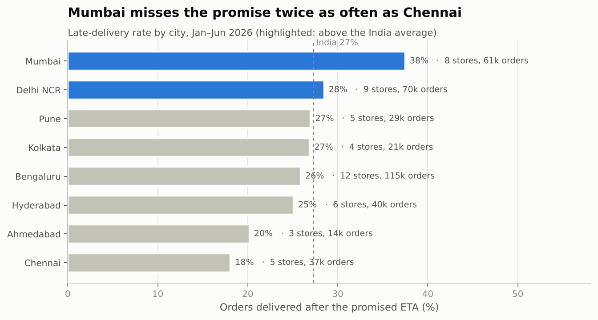 | 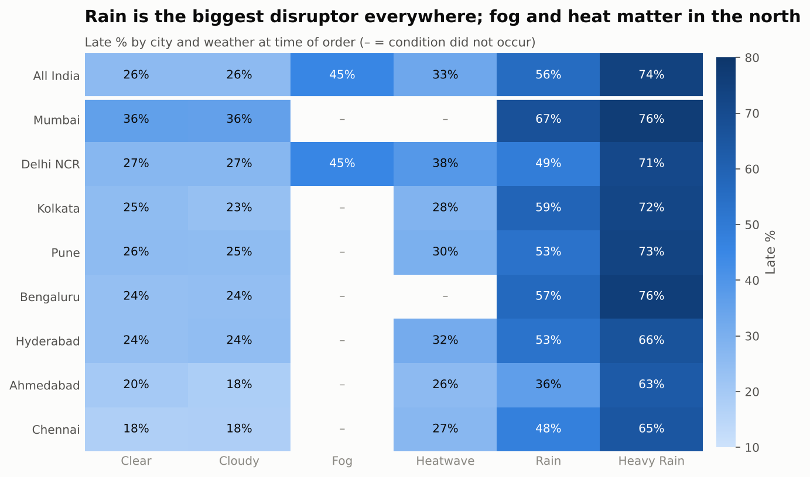 |
| 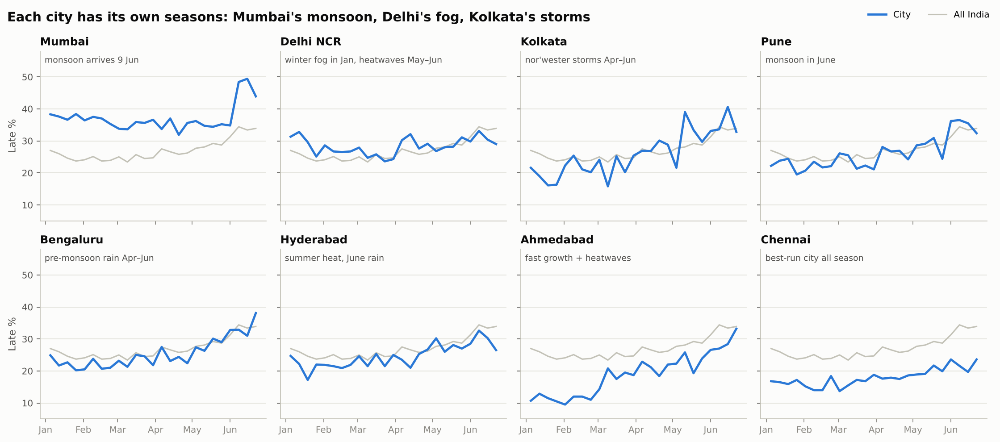 | 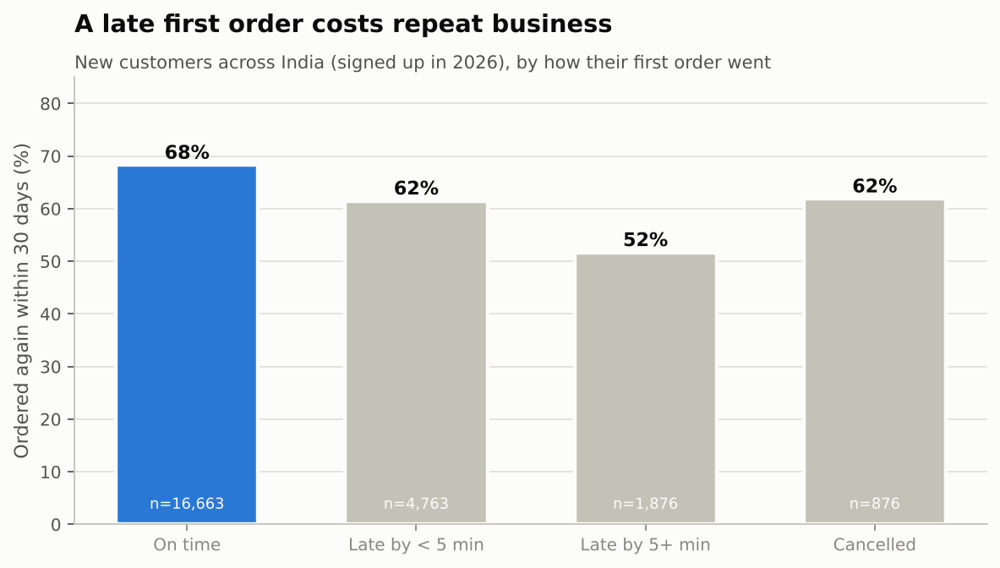 |
| 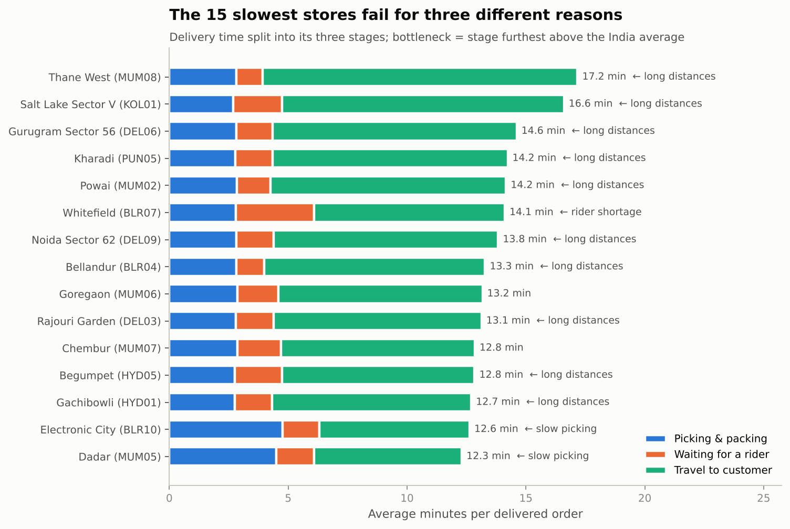 | 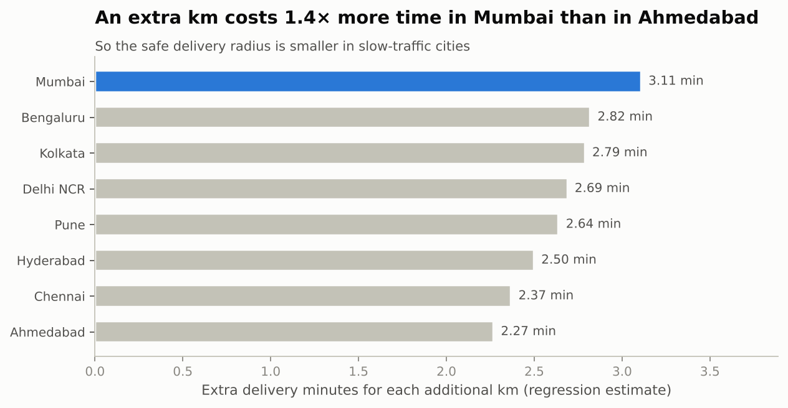 |
| 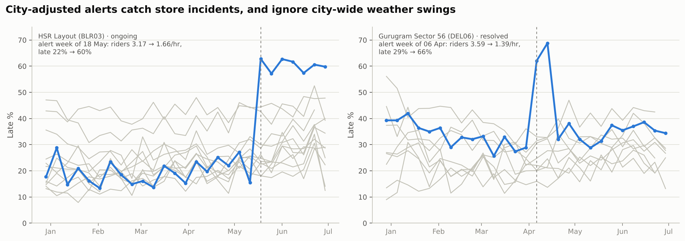 | 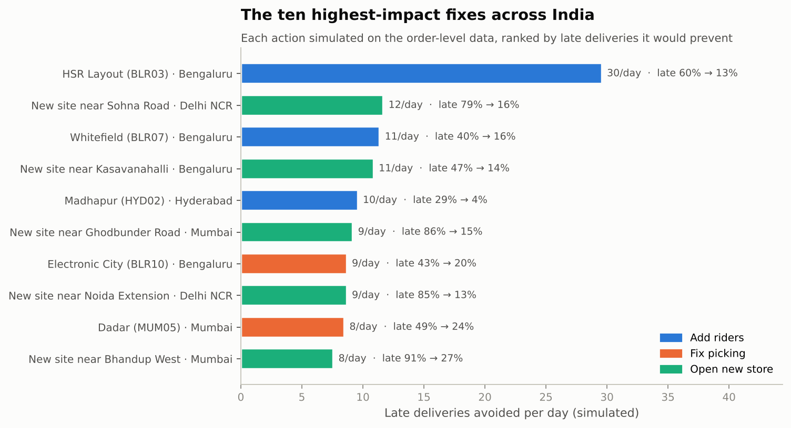 |
| 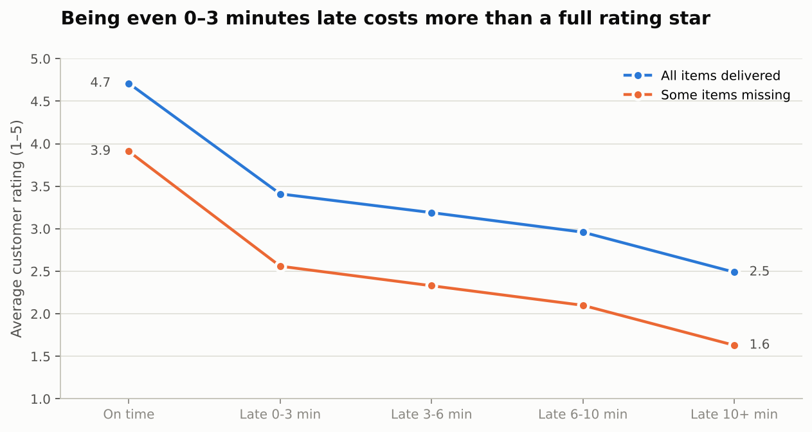 | 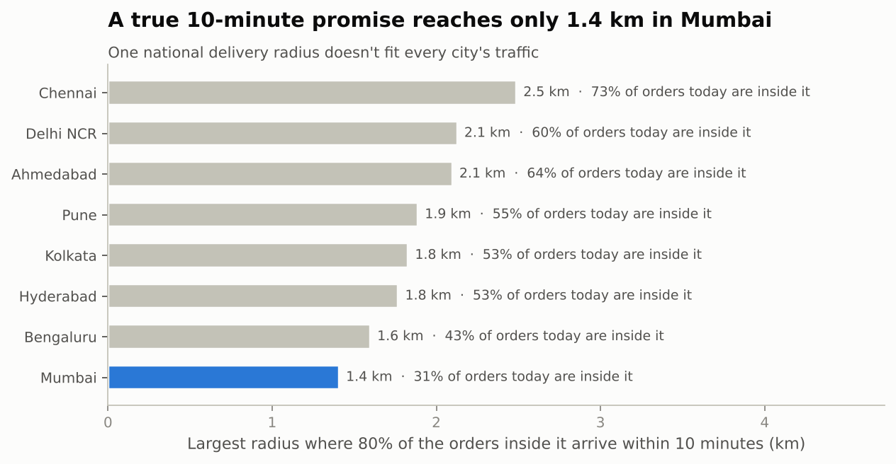 |

More in [`reports/figures/`](reports/figures), and the full walkthrough in [`notebooks/darkstore_analysis.ipynb`](notebooks/darkstore_analysis.ipynb).

## Approach

```
data/raw/ ──► sql/00_staging.sql ──► DuckDB star schema ──► sql/01–13 analysis ──► data/processed/*.csv
(messy export)  (clean + validate)    (facts & dimensions)    (city & store KPIs, …)        │
                                                                                            ▼
     src/analysis.py: regression · basket rules · city-adjusted alerts · what-if simulations · action plan
                                                                                            │
                     ┌─────────────────────────────┬────────────────────────────────┬──────┘
                     ▼                             ▼                                ▼
          Streamlit dashboard            reports/figures + metrics          Power BI export
```

1. **Data cleaning in SQL.** The raw export has duplicate rows (1,546), inconsistent store IDs (`blr07`, `␣BLR07`), drifting payment labels, impossible timestamps (delivered before dispatch, 3-hour deliveries) and missing distances. All are fixed or flagged in [`sql/00_staging.sql`](sql/00_staging.sql), with a [data quality report](reports/data_quality.md).
2. **City and store scorecards** ([`sql/02`](sql/02_city_scorecard.sql), [`sql/03`](sql/03_store_scorecard.sql)), comparing every store with its city and with India.
3. **Bottleneck diagnosis.** Delivery time is split into picking → rider wait → travel. Travel is judged on distance, not on the city's traffic, so a Mumbai store isn't flagged just because Mumbai roads are slow ([`sql/04`](sql/04_delivery_time_breakdown.sql)).
4. **Driver analysis.** Late rate by distance, rider load, weather and time of day for every city, plus an OLS regression with a separate distance slope per city and store fixed effects.
5. **City-adjusted incident monitoring.** Each store's weekly late rate against its own 8-week baseline, minus the city's own swing, and required to persist for a second week.
6. **Business impact.** First-order retention cohort, rating vs lateness, cancellations, stockout lost revenue.
7. **Basket analysis.** FP-Growth association rules over 373k delivered baskets.
8. **What-if simulations and action plan.** Every diagnosed problem gets a simulated fix on the order-level data (more riders, faster picking, or a new store in an under-served neighbourhood), and all fixes are ranked by late deliveries prevented.

## Dashboard

`streamlit run dashboard/app.py` opens **DarkStore Pulse**, a multi-page dashboard with city and period filters that carry across every page:

| Page | What it shows |
|---|---|
| **India** | Headline, KPI strip with trends, city league table with weekly sparklines, India map, and where to look first |
| **Cities** | City KPIs against India, store map with customer locations, store scorecard, weekly trend, weather impact |
| **Stores** | Any store's diagnosis: where the minutes go against its city and India, alerts, recommended fix, hourly profile, missed products |
| **Why orders are late** | Late rate by distance, rider load, weather and time of day; regression results; rating and retention impact |
| **Alerts** | The two incidents and why the city adjustment matters |
| **Stock & baskets** | Lost sales by category, summer ice cream spike, worst product–store pairs, bundle rules |
| **New stores** | Candidate sites on the map, ranked by late orders avoided |
| **Action plan** | All 21 fixes, filterable by type, downloadable as CSV |
| **About the data** | How the data was simulated and analysed, and the data quality log |

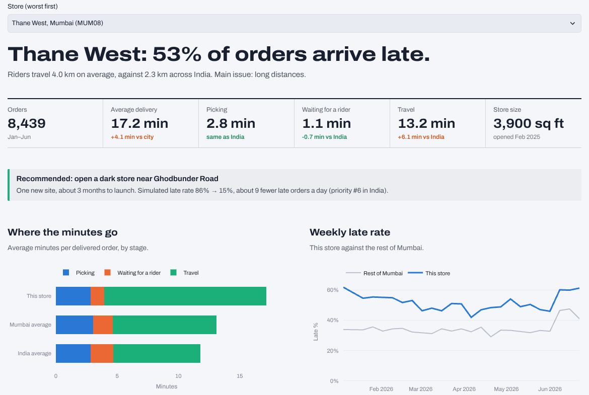

It supports light and dark themes and works on phones. A Power BI version can be built from the exported star schema; the data model, DAX measures and page layout are in [`docs/powerbi_guide.md`](docs/powerbi_guide.md).

## How to run

```bash
git clone https://github.com/Sujal-tyagi17/darkstore-performance-analysis.git
cd darkstore-performance-analysis
python -m venv .venv
.venv\Scripts\activate         # Windows; on macOS/Linux: source .venv/bin/activate
pip install -r requirements.txt

python run_all.py              # warehouse + SQL + analysis + charts + Power BI export (about 1 minute)
pytest -q                      # 15 data-integrity and sanity tests
streamlit run dashboard/app.py # dashboard at http://localhost:8501

python run_all.py --regen      # optional: regenerate the raw data (seeded, reproducible)
```

**Live version:** [darkstore-pulse-india.streamlit.app](https://darkstore-pulse-india.streamlit.app/), deployed on Streamlit Community Cloud (main file `dashboard/app.py`, Python 3.13). It builds the warehouse from the committed raw data on first load and redeploys automatically on every push to `main`.

## About the data

Real dark-store data isn't public, so [`src/generate_data.py`](src/generate_data.py) **simulates** it with an explicit operational model rather than random numbers:

- **Delivery time = picking + rider wait + travel.** Picking grows with basket size; rider wait rises sharply once orders outnumber riders; travel grows with distance and each city's traffic, and is hit by rain, fog and heatwaves.
- **City calendars:** Mumbai's June monsoon, Delhi's winter fog and summer heatwaves, Kolkata's April–May nor'westers, summer heat in Ahmedabad, Hyderabad and Chennai, and regional festivals (Pongal, Uttarayan, Holi, Ugadi and Gudi Padwa, Eid, Poila Baisakh).
- **Demand** follows hour-of-day and weekday patterns, monthly growth, festivals and weather. Baskets come from shopping "missions" (breakfast, evening snacks, cooking, cold drinks in a heatwave…) that depend on time, season, weather and customer segment.
- **Customers react:** late deliveries and missing items lower ratings and raise the chance a customer stops ordering.
- **Store conditions** were set for a realistic mix of problems (staffing levels, store layouts, catchment areas, two rider incidents, small freezers, late dairy restocks, fast-growing suburbs). The analysis had to *find and quantify* them from the order data alone.

Because the data is simulated, treat the exact numbers as an illustration of the method. The retention comparison is observational (customers with late first orders also tend to live further away), and the what-if simulations hold other factors constant.

## Repository structure

```
├── data/
│   ├── raw/                 # orders, items, customers, rider shifts, weather (Parquet) + cities, stores, products
│   └── processed/           # outputs of every SQL query and model (dashboard inputs)
├── sql/                     # 00_staging (cleaning + star schema), 01–13 analysis queries
├── src/
│   ├── generate_data.py     # operational simulation that produces the raw data
│   ├── build_warehouse.py   # runs the SQL in DuckDB, writes processed tables + data quality report
│   ├── analysis.py          # regression, basket rules, alerts, what-if simulations, action plan
│   ├── charts.py            # report charts
│   └── export_powerbi.py    # star-schema CSVs for Power BI
├── dashboard/
│   ├── app.py               # Streamlit entry point (navigation + shared filters)
│   ├── lib.py               # data access, theme and UI components
│   ├── views/               # one file per page
│   └── static/fonts/        # self-hosted Archivo font (SIL Open Font License)
├── .streamlit/config.toml   # light and dark themes
├── notebooks/               # narrative walkthrough of the analysis
├── reports/                 # figures, metrics.json, data_quality.md
├── docs/                    # Power BI guide (data model + DAX), dashboard screenshots
├── tests/                   # pytest data-integrity checks
└── run_all.py               # one-command pipeline
```

---

**Author:** Sujal Tyagi · [GitHub](https://github.com/Sujal-tyagi17)
