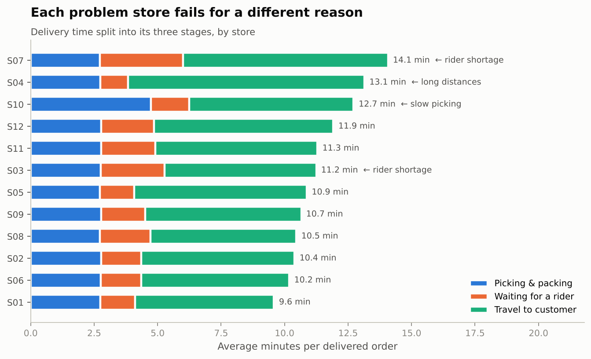
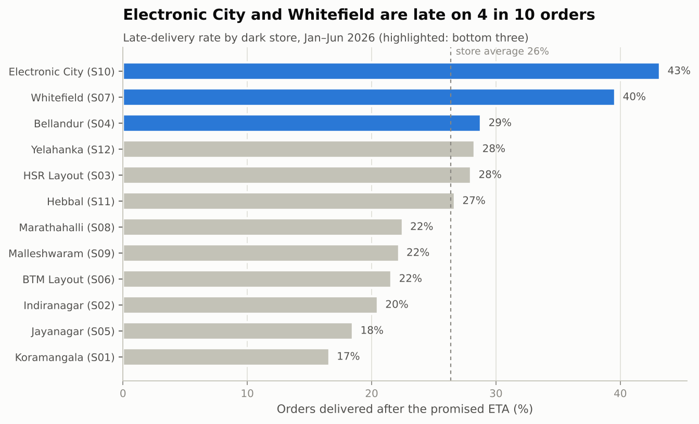
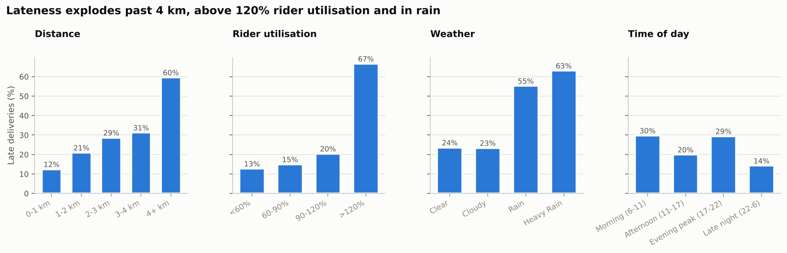
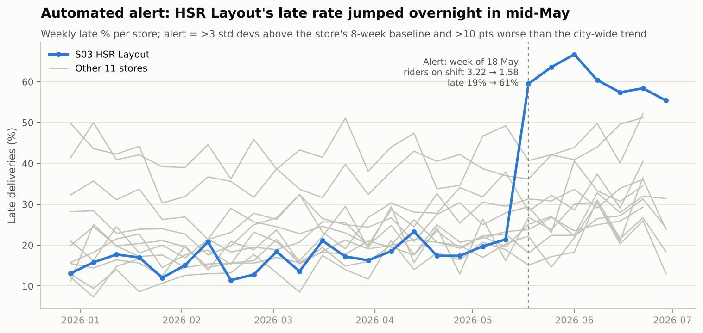
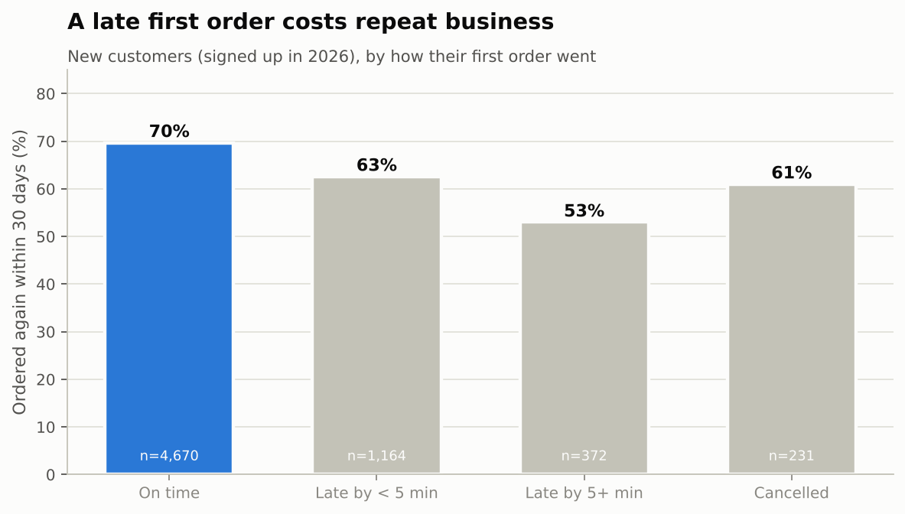
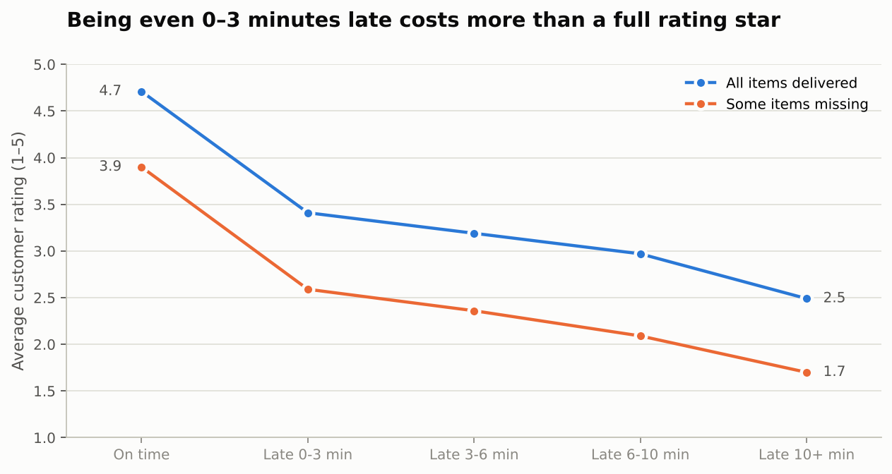
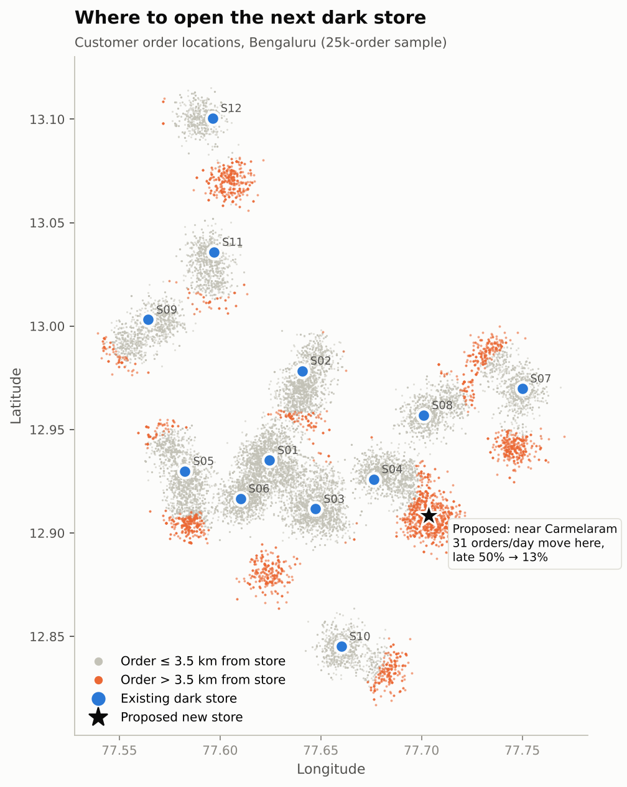

# DarkStore Pulse: Why quick-commerce orders arrive late

**An end-to-end analysis of 114,652 orders from 12 dark stores in Bengaluru (Jan–Jun 2026), from raw data to a diagnosis and five costed recommendations.**

`SQL (DuckDB)` · `Python (pandas, statsmodels, scikit-learn, mlxtend)` · `Streamlit + Plotly` · `Power BI-ready star schema` · `pytest`



---

## The business question

A 10-minute delivery company is growing fast (+21% monthly orders from January to June), but **the share of orders delivered after the promised ETA rose from 22.5% to 33.6%**. Operations wants to know:

1. Which stores are failing, and **why** each one fails?
2. What is lateness costing in ratings, repeat orders and revenue?
3. What should we fix first, and how much will it help?

## Key findings

| # | Finding | Evidence |
|---|---|---|
| 1 | **Three stores fail for three different reasons.** Splitting delivery time into picking, rider wait and travel names each bottleneck. | Whitefield (S07): orders wait **3.3 min** for a rider vs 1.8 network → understaffed. Bellandur (S04): travel **9.3 min** vs 6.6 → serves areas too far away. Electronic City (S10): picking **4.7 min** vs 2.9 → slow in-store. |
| 2 | **Distance, rider load and rain drive lateness; time of day matters less.** | Late rate: **60%** for 4+ km orders vs 12% under 1 km · **67%** when rider utilisation > 120% · **55–63%** in rain vs 24% in clear weather. Regression (R² = 0.83): each extra km adds **2.8 min**; heavy rain adds **2.7 min**. |
| 3 | **Only Electronic City is slow "for no outside reason."** | With distance, weather, traffic and rider load controlled, every store's fixed effect is ≈ 0 except S10 at **+2.0 min**. Its problem is inside the store. |
| 4 | **An automated monitor caught HSR Layout's collapse in the week it happened.** | From 18 May, riders on shift fell **3.2 → 1.6 per hour**; rider wait rose 1.5 → 6.4 min; late rate jumped **19% → 61%**. Picking and travel didn't change. |
| 5 | **Lateness costs repeat business.** | New customers whose first order was late re-ordered within 30 days **9.4 pts less often** (60.3% vs 69.7%). Ratings drop from **4.7 to 3.4** for orders just 0–3 min late. 1,859 orders were cancelled because delivery was taking too long (≈ ₹5.8 L GMV). |
| 6 | **A growing neighbourhood is being lost to bad service.** | Carmelaram signups rose from 1 in January to 117 in June, yet its orders fell **18%**: about **3 in 4 orders there arrive late** (avg 5.7 km from the nearest store). |
| 7 | **Stockouts cost ≈ ₹1.4 L a month,** led by summer ice cream at small-freezer stores and morning bread/milk at Whitefield & Marathahalli. | At Jayanagar the vanilla tub was unavailable on **1 in 3** requests in Apr–May (vs 1–3% other months); ₹75k lost on ice cream at S05/S10 alone. |

## Recommendations (each simulated on the data)

| Priority | Action | What it takes | Simulated impact |
|---|---|---|---|
| 1 | **Restore rider capacity at HSR Layout (S03)** | +23 rider-hours/day, mainly 7–11 pm | Late rate **61% → 13%** |
| 2 | **Add rider shifts at Whitefield (S07)** | +12 rider-hours/day, at 8–10 am and 7–9 pm | Late rate **40% → 15%** |
| 3 | **Fix picking at Electronic City (S10)**: re-slot fast movers near packing, audit layout (smallest store at 2,600 sq ft) | Cut ~2 min of picking per order | Late rate **43% → 19%** |
| 4 | **Open a dark store near Carmelaram** | 1 new site (K-means on far-away orders) | ~31 orders/day move over; their distance **4.8 → 1.5 km**, late rate **50% → 13%**; network late rate −1.9 pts |
| 5 | **Bigger freezers at S05/S10 before summer; earlier dairy & bread restock at S07/S08** | Capex + vendor slot change | Recovers part of ₹1.4 L/month in lost sales |

Quick wins: show *"frequently bought together"* prompts for the strongest basket rules (baby wipes → diapers, lift 14.5; cup noodles → masala noodles, lift 6.1; dishwash bar → liquid detergent, lift 7.3).

## Charts

| | |
|---|---|
|  |  |
|  |  |
|  |  |

More in [`reports/figures/`](reports/figures) and the full walkthrough in [`notebooks/darkstore_analysis.ipynb`](notebooks/darkstore_analysis.ipynb).

## Approach

```
data/raw/*.csv ──► sql/00_staging.sql ──► DuckDB star schema ──► sql/01–11 analysis ──► data/processed/*.csv
 (messy export)     (clean + validate)     (fact & dim tables)    (KPIs, scorecard, …)        │
                                                                                               ▼
                       src/analysis.py: regression · basket rules · anomaly alerts · what-if simulations
                                                                                               │
                         ┌───────────────────────────┬─────────────────────────────┬──────────┘
                         ▼                           ▼                             ▼
              Streamlit dashboard          reports/figures + metrics      Power BI export
```

1. **Data cleaning in SQL.** The raw export contains duplicate rows (459), inconsistent store IDs (`s07`, `␣S07`), drifting payment labels, impossible timestamps (delivered before dispatch, 3-hour deliveries) and missing distances. All are fixed or flagged in [`sql/00_staging.sql`](sql/00_staging.sql), with a [data quality report](reports/data_quality.md).
2. **Store scorecard and diagnosis.** Delivery time is decomposed into picking → rider wait → travel, and each stage is compared with the network to name the bottleneck ([`sql/03`](sql/03_delivery_time_breakdown.sql)).
3. **Driver analysis.** Late rate by distance, rider utilisation, weather and time of day, plus an OLS regression with store fixed effects to separate overlapping effects.
4. **Incident monitoring.** Weekly late rate per store vs its own 8-week baseline, adjusted for city-wide swings (so monsoon weeks don't trigger false alarms).
5. **Business impact.** First-order retention cohort, rating vs lateness, cancellations, and stockout lost revenue.
6. **Basket analysis.** FP-Growth association rules over 110k delivered baskets.
7. **What-if simulations.** Each recommendation is tested on the order-level data: adding riders (re-pricing wait time from the network's utilisation curve), faster picking, and a new store (K-means on far-away orders, re-routing and re-applying ETA tiers).

## Dashboard

`streamlit run dashboard/app.py` opens **DarkStore Pulse**, a seven-tab dashboard with date and store filters: Overview · Store scorecard (with drill-down) · Why orders are late · Incident monitor · Stockouts & baskets · Next store location (map) · Recommendations.

A Power BI version can be built from the exported star schema; the data model, DAX measures and page layout are in [`docs/powerbi_guide.md`](docs/powerbi_guide.md).

## How to run

```bash
git clone https://github.com/Sujal-tyagi17/darkstore-performance-analysis.git
cd darkstore-performance-analysis
pip install -r requirements.txt

python run_all.py              # warehouse + SQL + analysis + charts + Power BI export (~30 s)
pytest -q                      # 11 data-integrity and sanity tests
streamlit run dashboard/app.py # dashboard at http://localhost:8501

python run_all.py --regen      # optional: regenerate the raw data (seeded, reproducible)
```

**Deploying the dashboard:** on [Streamlit Community Cloud](https://share.streamlit.io), create an app from this repo with main file `dashboard/app.py`. It builds the warehouse from the committed CSVs on first load.

## About the data

Real dark-store data isn't public, so [`src/generate_data.py`](src/generate_data.py) **simulates** it with an explicit operational model rather than random numbers:

- **Delivery time = picking + rider wait + travel.** Picking grows with basket size; rider wait rises sharply once orders per rider exceed capacity; travel grows with distance, peak-hour traffic and rain.
- **Demand** follows hour-of-day and weekday patterns, monthly growth, festivals and rain (people order in when it rains). Baskets come from shopping "missions" (breakfast, evening snacks, cooking, baby care…) that depend on time of day, season and customer segment.
- **Customers react:** late deliveries and missing items lower ratings and raise the chance a customer stops ordering.
- **Store-level conditions** were set for a realistic mix of problems (staffing levels, store layouts, catchment areas, a rider-attrition event and seasonal freezer constraints). The analysis had to *find and quantify* them from the order data alone; the regression, monitor and simulations recover them independently.

Because the data is simulated, treat the exact numbers as an illustration of the method. The retention comparison is observational (late-first-order customers also tend to live further away), and the what-if simulations hold other factors constant.

## Repository structure

```
├── data/
│   ├── raw/                 # orders, order_items, customers, stores, products, rider_shifts, weather
│   └── processed/           # outputs of every SQL query and model (dashboard inputs)
├── sql/                     # 00_staging (cleaning + star schema), 01–11 analysis queries
├── src/
│   ├── generate_data.py     # operational simulation that produces the raw data
│   ├── build_warehouse.py   # runs the SQL in DuckDB, writes processed tables + data quality report
│   ├── analysis.py          # regression, basket rules, anomaly alerts, what-if simulations
│   ├── charts.py            # report charts
│   └── export_powerbi.py    # star-schema CSVs for Power BI
├── dashboard/app.py         # Streamlit dashboard
├── notebooks/               # narrative walkthrough of the analysis
├── reports/                 # figures, metrics.json, data_quality.md
├── docs/powerbi_guide.md    # data model + DAX measures
├── tests/                   # pytest data-integrity checks
└── run_all.py               # one-command pipeline
```

---

**Author:** Sujal Tyagi · [GitHub](https://github.com/Sujal-tyagi17)
